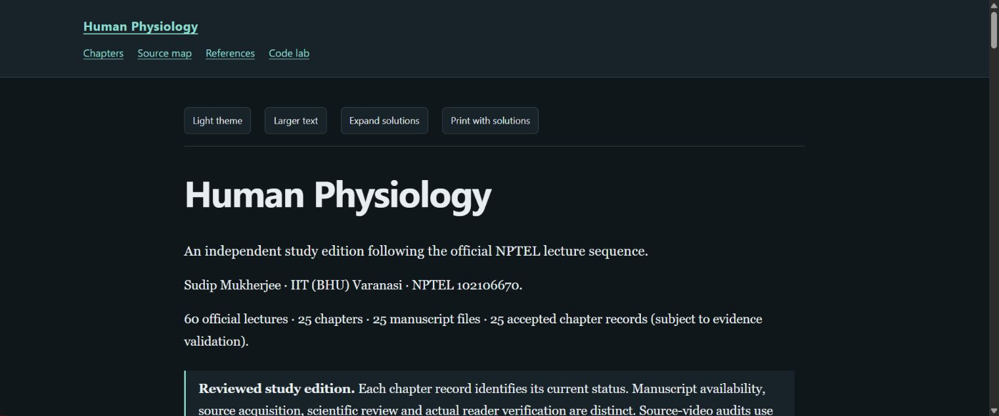

# Human Physiology

Independent study notes following **Prof. Sudip Mukherjee, IIT (BHU) Varanasi**, [NPTEL course 102106670](https://nptel.ac.in/courses/102106670).

[Read online](https://az9713.github.io/nptel-human-physiology-iitbhu-notes/) · [Chapter index](index.html) · [Source map](source-map.html) · [Code lab](code-lab.html)

The book contains 25 accepted chapters covering the official 60-lecture sequence, with worked problems, controlled animations, static print alternatives and reproducible teaching calculations. Every chapter received two actual independent AI scientific/editorial full reviews, necessary targeted repairs and separate bounded browser/print checks. These checks are not human expert certification or clinical validation.

The supplied [YouTube playlist](https://www.youtube.com/playlist?list=PLyqSpQzTE6M_4jmZrdBaHSQyViWt4w0S5) is out of order and omits official lecture 20; the inventory includes its recovered recording and lists the short introduction separately. The official recordings total about 29.3 hours. Complete publisher captions and bounded visual audits cover all 60 recordings; 3,548 sampled frames were acquired. This is not a claim of continuous audio/video viewing.

The visual plan records 73 animations and 35 supporting illustrations across 101 section nodes. Time-evolving mechanisms use controlled playback, seeking and explanations, with plots where useful. Verified microscopy/imaging supplies observed tissue appearance; original diagrams and selected source-based 3D explain topology and movement. Species, preparation, scale, artificial timing and model limits are stated at point of use. A still image does not establish physiological kinetics.

## Read the chapters online

| Chapter | Topic |
| --- | --- |
| 1 | [From cells to organ systems](https://az9713.github.io/nptel-human-physiology-iitbhu-notes/chapter-01-cells-to-organ-systems.html) |
| 2 | [Membrane transport and homeostasis](https://az9713.github.io/nptel-human-physiology-iitbhu-notes/chapter-02-membrane-transport-homeostasis.html) |
| 3 | [Blood, hemostasis and anticoagulation](https://az9713.github.io/nptel-human-physiology-iitbhu-notes/chapter-03-blood-hemostasis-anticoagulation.html) |
| 4 | [Blood groups, lymph and immune defense](https://az9713.github.io/nptel-human-physiology-iitbhu-notes/chapter-04-blood-groups-lymph-immunity.html) |
| 5 | [The heart as an electrical and mechanical pump](https://az9713.github.io/nptel-human-physiology-iitbhu-notes/chapter-05-heart-electrical-mechanical-pump.html) |
| 6 | [Blood vessels and microvascular exchange](https://az9713.github.io/nptel-human-physiology-iitbhu-notes/chapter-06-vessels-microvascular-exchange.html) |
| 7 | [Airways, ventilation and hemoglobin](https://az9713.github.io/nptel-human-physiology-iitbhu-notes/chapter-07-airways-ventilation-hemoglobin.html) |
| 8 | [Oxygen delivery, lung volumes and measurement](https://az9713.github.io/nptel-human-physiology-iitbhu-notes/chapter-08-oxygen-delivery-lung-volumes.html) |
| 9 | [Endocrine signaling and glucose homeostasis](https://az9713.github.io/nptel-human-physiology-iitbhu-notes/chapter-09-endocrine-signaling-glucose.html) |
| 10 | [Diabetes technologies and experimental cell therapy](https://az9713.github.io/nptel-human-physiology-iitbhu-notes/chapter-10-diabetes-technologies-cell-therapy.html) |
| 11 | [Thyroid and endocrine disorders](https://az9713.github.io/nptel-human-physiology-iitbhu-notes/chapter-11-thyroid-endocrine-disorders.html) |
| 12 | [Digestive organization and carbohydrate absorption](https://az9713.github.io/nptel-human-physiology-iitbhu-notes/chapter-12-digestion-carbohydrate-absorption.html) |
| 13 | [Protein and lipid absorption; digestive dysfunction](https://az9713.github.io/nptel-human-physiology-iitbhu-notes/chapter-13-protein-lipid-digestion.html) |
| 14 | [Bones, joints and connective tissues](https://az9713.github.io/nptel-human-physiology-iitbhu-notes/chapter-14-bones-joints-connective-tissue.html) |
| 15 | [Muscle contraction and neuromuscular transmission](https://az9713.github.io/nptel-human-physiology-iitbhu-notes/chapter-15-muscle-neuromuscular-transmission.html) |
| 16 | [Kidney organization and glomerular filtration](https://az9713.github.io/nptel-human-physiology-iitbhu-notes/chapter-16-kidney-glomerular-filtration.html) |
| 17 | [Tubular transport, renal regulation and disease](https://az9713.github.io/nptel-human-physiology-iitbhu-notes/chapter-17-nephron-transport-pressure.html) |
| 18 | [Male reproduction and spermatogenesis](https://az9713.github.io/nptel-human-physiology-iitbhu-notes/chapter-18-male-reproduction-spermatogenesis.html) |
| 19 | [Female anatomy, ovarian cycles and lactation](https://az9713.github.io/nptel-human-physiology-iitbhu-notes/chapter-19-female-reproduction-ovarian-cycle.html) |
| 20 | [Menstrual regulation, fertilization and pregnancy](https://az9713.github.io/nptel-human-physiology-iitbhu-notes/chapter-20-menstrual-cycle-pregnancy.html) |
| 21 | [Contraception, assisted reproduction and reproductive health](https://az9713.github.io/nptel-human-physiology-iitbhu-notes/chapter-21-reproductive-health-technologies.html) |
| 22 | [Nervous-system organization: brain, spinal cord and nerves](https://az9713.github.io/nptel-human-physiology-iitbhu-notes/chapter-22-nervous-system-organization.html) |
| 23 | [Neurons, axonal transport and nerve repair](https://az9713.github.io/nptel-human-physiology-iitbhu-notes/chapter-23-neurons-axonal-transport-repair.html) |
| 24 | [Membrane excitability and synaptic transmission](https://az9713.github.io/nptel-human-physiology-iitbhu-notes/chapter-24-membrane-excitability-synapses.html) |
| 25 | [Glia, sensory systems and neurological dysfunction](https://az9713.github.io/nptel-human-physiology-iitbhu-notes/chapter-25-glia-barriers-sensation.html) |

## Run locally

Use **Python 3.10+**. The 25 declared chapter calculation labs use the standard library. Serve the reader over loopback HTTP so data/geometry panels can load:

~~~sh
python -X utf8 tools/preview_public.py --port 8765
~~~

Open the printed local URL. Reader scripts, MathJax and displayed data are bundled; external source links require internet access. Run a chapter lab using its command in [Code lab](code-lab.html).

## Rebuild and validate

~~~sh
python -X utf8 tools/export_plan.py
python -X utf8 tools/build_book.py
python -X utf8 tools/validate_book.py --public --release
~~~

Public validation checks all 25 current accepted snapshots against sanitized [producer attestations](validation/README.md). It does not reconstruct private reviews or certify biological truth. The producer separately validates actual private reports and exports the portable records; those private tools/evidence are deliberately excluded.

| Optional task | Additional requirements |
| --- | --- |
| JavaScript calculation checks | Modern Node.js; tested with 22.22.0 |
| Source-based knee reference projection | NumPy and Pillow; [reproduction scope](assets/ch14-knee-reproduction.md) |
| Retained anatomical render sources | Blender, applicable MPFB/HRA assets and separately acquired inputs described in source headers |
| Historical scaffold browser harness | Playwright and compatible browser; tests scaffold/pilot only, not final chapter acceptance |

The 25 labs, 11 public JavaScript check scripts and the chapter 15 static validator passed the release reproduction audit; 32 intercepted numerical/static outputs matched the bundled bytes. Optional upstream asset reacquisition and full Blender/knee repacking are separate workflows, with their input limits documented.

## Sources, rights and evidence

- [Lecture inventory](lecture-inventory.csv) and [references](references.html)
- [Asset credits and licences](assets/ATTRIBUTION.md), including individual image/geometry notices
- [Visual-resource research](research/VISUAL_RESOURCES.md) and [production workflow](WORKFLOW.md)
- [Chapter/visual plan](plan/outline.md) and [completion record](completion.json)

Raw captions, lecture videos/slides, private reviews, browser proofs, credentials and personal absolute paths are excluded from publication. No original lecture artwork is relicensed by this repository. Third-party assets/dependencies retain their own notices, including the applicable GSAP licence; no blanket licence overrides them.
